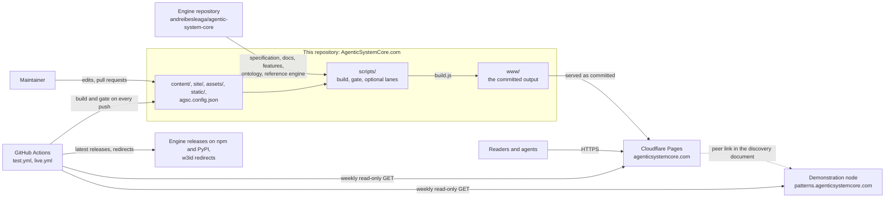

# The system around this repository

**Summary.** This repository is the source of a static site. The picture shows who and what
touches it: the engine repository it is built with, the host that serves the committed
output, the demonstration node it links to, and the GitHub Actions workflows that check
it. The tables list what each folder is for and what CI runs and when. How the build itself
works is in [BUILD.md](BUILD.md).

**Who this is for:** a contributor to the generator, or anyone who must keep the site
running. **Read after:** the repository [README](../README.md).

The site has no application server, no database and no login ([SECURITY.md](../SECURITY.md)).
Nothing configures its version: the build derives the content version from this
repository's git log and its `v*` tags (`v1.0.0` today), as the engine's rule says
([Committing the output](BUILD.md#committing-the-output)).

## Parts

| Folder or file | Purpose |
|---|---|
| `content/` | the Bundle's items (see [content/README.md](../content/README.md)) |
| `site/` | authored pages, diagram sources, the agent skill (see [site/README.md](../site/README.md)) |
| `assets/`, `static/` | files the build copies (see [assets/README.md](../assets/README.md), [static/README.md](../static/README.md)) |
| `scripts/` | the generator, the gate, the optional lanes (see [scripts/README.md](../scripts/README.md)) |
| `agsc.config.json` | the Bundle's configuration: site title and base address, output folder `www`, the peer node, the allowed tags, the contribution route |
| `.public-hygiene.json` | the allow-list of the engine's `tools/public-hygiene` sweep, each entry with its reason |
| `AGENTS.md` | orientation for coding assistants: layout, check commands, rules |
| `www/` | the built site, committed; never edited by hand |
| `dist/` | scratch space of the engine step, not committed (`.gitignore`) |

## What CI runs

Both workflows pin every action by commit SHA; Dependabot proposes updates to those pins
monthly, in one pull request (`.github/dependabot.yml`). No workflow uses a secret.

| Workflow | When | What |
|---|---|---|
| `test.yml`, job `site (build, gate, page tools, hygiene)` | every push, every pull request, on request | installs the engine (`npm ci`) at `ENGINE_REF` (`main`); runs the helper tests; on a pull request that changes `www/`, `node scripts/check.js` alone; then `node scripts/build.js && node scripts/check.js`, `node scripts/page-tools-check.js` and the engine's `tools/public-hygiene` over this repository |
| `test.yml`, job `browser lane (on request)` | a manual run with `a11y` ticked, or the repository variable `AGSC_A11Y` set to `true` | `node scripts/a11y.js` over the committed output |
| `live.yml` | Mondays 06:17 UTC, on request | `node scripts/live-check.mjs --require-checkers`: a read-only check of both live nodes; never blocks a pull request |

The `site` job is the required check on `main`, which takes changes through pull requests
(GitHub branch protection, read on 29 October 2026). The gate reads the engine's `main`, so
a red run after a change in the engine usually means the site must be rebuilt, and `www/`
committed on its own. GitHub switches a scheduled workflow off after 60 days without
activity in the repository; a manual run of `live.yml` switches it on again.
