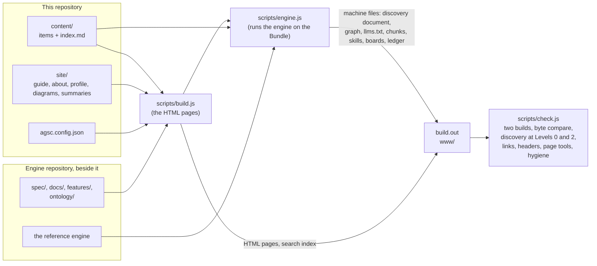

# How this site is built

**Summary.** One command, `node scripts/build.js`, turns this repository's Bundle and
authored pages, together with the engine repository beside it, into the static site in
`build.out`. The generator writes the HTML pages; the reference engine writes every
machine file whose bytes a rule pins; the gate, `node scripts/check.js`, builds twice,
compares the bytes and checks the result as a stranger would. Nothing is fetched from the
network, and the build instant is fixed, so the same inputs always give the same site.

**Who this is for:** a contributor to the generator or a reviewer of the site's output.
**Read after:** the repository [README](../README.md).

The picture above is rendered from this Mermaid source; the source is the truth.

## The parts

| Step | What happens | Where |
|---|---|---|
| Read | the configuration, the items of `content/`, the guide pages of `site/docs/`, and from the engine repository the specification, the requirements, the scenarios, the ontology and the plain-language pages | `scripts/build.js` |
| Engine | the Bundle is copied to `dist/engine-bundle/` and built by the engine; its machine files (discovery document, graph views, `llms.txt`, chunks, search index, skill packs, boards, ledger, `/ns/`) are taken as they are | `scripts/engine.js` |
| Pages | every HTML page — items, the specification, the guide, search, compose, the graph explorer, the front page — in the engine's default theme | `scripts/build.js` |
| Copies | the files of `assets/` the build names, the icon and the touch icon, and from `static/` the signed sustainability report and the frozen vocabulary copies, byte for byte | `scripts/build.js` |
| Front page | the "works with" lists are read from the engine's registries and the measured numbers from its `docs/measurements.json`; the build stops if a name on the page has no registry entry | `scripts/build.js` |
| Gate | two builds must be byte-identical; the discovery document passes the engine's `tools/validate-wellknown` at Levels 0 and 2; links, headers, contrast, the page tools, the content checks and public hygiene are checked | `scripts/check.js`, `scripts/check-content.js` |

The instant every date on the site derives from is `SOURCE_DATE_EPOCH`, or the last
commit when it is unset. Until the specification's tag exists the build reads the
engine's working tree, and says so in its first line of output.

## Committing the output

The output records a content version that names the commit the build ran on: a build at
commit `601ab7b19217…` records `v1.0.0+35.g601ab7b19217`. The output is committed after the
build, so `www/` always names the commit before the one that holds it. `node scripts/check.js`
accounts for this (`scripts/built-commit.js`): it builds at the commit `www/` names and
compares, and it fails when anything outside `www/` has changed since that commit. So:

1. Commit and merge the change to the sources (`content/`, `site/`, `scripts/`, `assets/`,
   `static/`).
2. Run `node scripts/build.js` and commit the changed `www/` on its own, in the same pull
   request or the next; earlier ones are titled "Rebuild www: …" (`git log -- www`).
3. `node scripts/check.js` passes on that commit.

Until step 2, `node scripts/check.js` alone reports the committed output as stale. The CI
run does not: on a push it runs `build.js` first, which overwrites `www/` in the runner, so
it proves the sources; only a pull request that changes `www/` gets `check.js` alone, which
proves the committed output ([ARCHITECTURE.md](ARCHITECTURE.md) lists what CI runs). A
published change is undone by reverting its commits through a pull request; the host serves
`www/` as committed.
